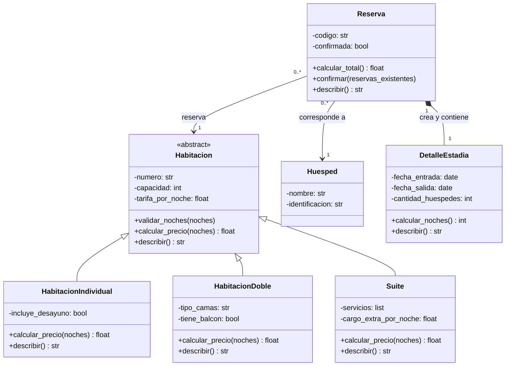

# Diagrama UML — Sistema de Reservas de Hotel

El diagrama representa el diseño previsto del sistema.
La clase Huesped está pendiente de incorporación.

## Relaciones

- Herencia: HabitacionIndividual, HabitacionDoble y Suite son tipos de Habitacion.
- Asociación: cada Reserva corresponde a un Huesped y a una Habitacion.
- Composición: Reserva crea y contiene su propio DetalleEstadia.
- Un huésped o una habitación pueden estar asociados a varias reservas.
- Las reservas confirmadas de una misma habitación no pueden tener fechas que se crucen.
