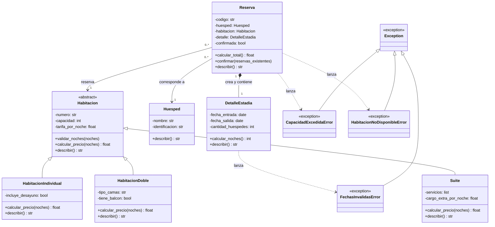

# Diagrama UML — Sistema de Reservas de Hotel

## Relaciones del sistema

- **Herencia:** HabitacionIndividual, HabitacionDoble y Suite
  heredan de la clase abstracta Habitacion.
- **Asociación:** cada Reserva se relaciona con un Huesped
  y una Habitacion. Estos objetos pueden existir independientemente
  de la reserva.
- **Composición:** cada Reserva crea y contiene un DetalleEstadia
  exclusivo que forma parte de su estructura.
- **Herencia de excepciones:** las tres excepciones personalizadas
  heredan de Exception, una clase incorporada de Python.
- **Dependencia:** las flechas discontinuas indican qué clases
  lanzan las excepciones personalizadas.

## Reglas de disponibilidad

Una habitación puede participar en varias reservas,
pero sus reservas confirmadas no pueden tener fechas cruzadas.

Se permite que una reserva comience el mismo día
en que termina otra. Las reservas pendientes no bloquean
la disponibilidad.

## Encapsulamiento

El signo menos representa los atributos privados.
El signo más representa los métodos públicos.

El código utiliza propiedades para consultar los atributos
de las entidades.